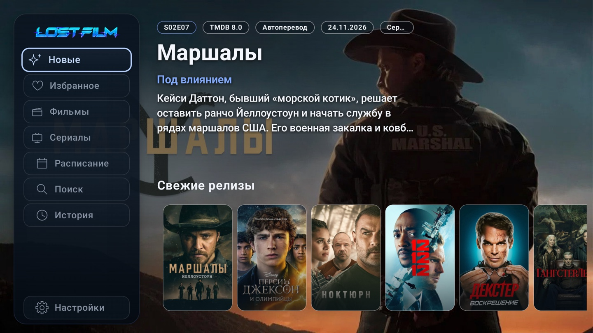
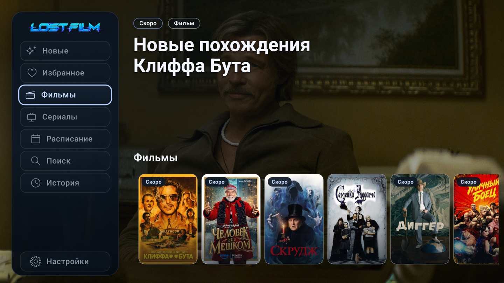
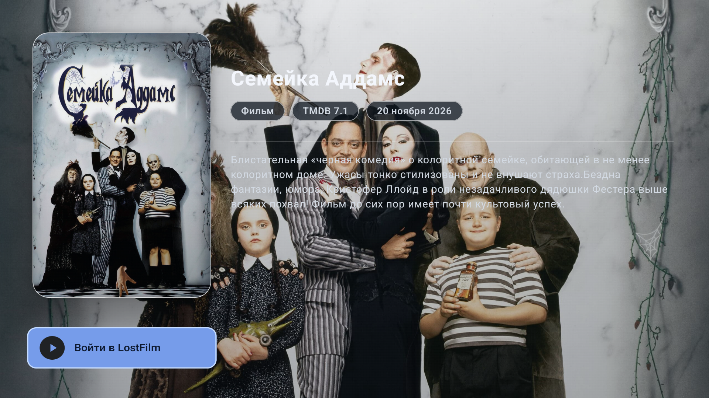
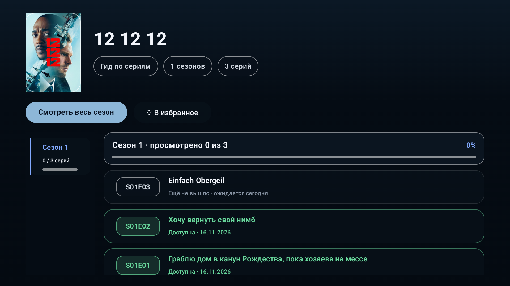
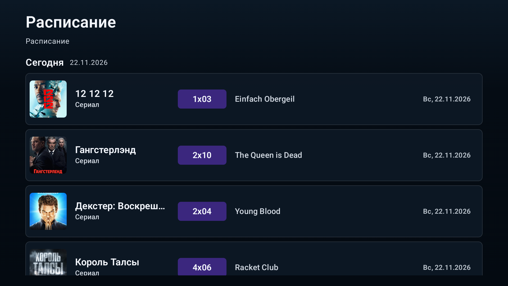
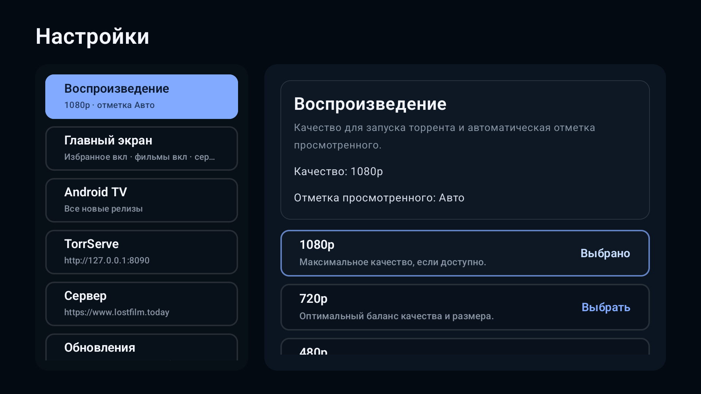
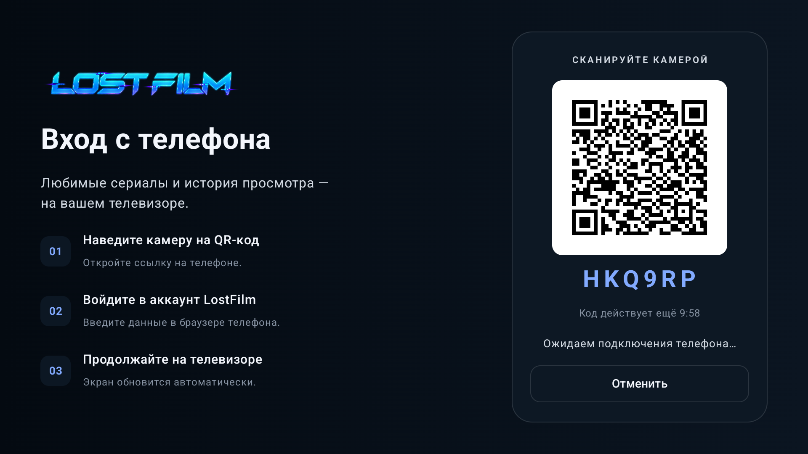

# LostFilm New TV

> **Отказ от ответственности**
>
> Это неофициальный Android TV клиент для `lostfilm.today`. Проект не связан с LostFilm.TV или правообладателями контента.

Android TV приложение для просмотра новых релизов, фильмов, расписания и избранного LostFilm в интерфейсе, оптимизированном для управления пультом.

> 💻 **Для разработчиков:** см. [DEVELOPMENT.md](DEVELOPMENT.md) для информации о сборке, разработке и контрибуции.

## Возможности

- Новые релизы: одна карточка сериала с последней вышедшей серией, без повторов при подгрузке
- Отдельный раздел фильмов с `lostfilm.today`
- Поиск по каталогу с голосовым вводом через сервис телевизора
- Расписание релизов с крупными постерами TMDB
- Избранное: одна карточка на сериал после входа в аккаунт LostFilm
- QR-авторизация через собственный сервер и домен, без ввода логина и пароля на телевизоре
- Карточка релиза с постером, описанием, рейтингом TMDB и торрент-раздачами
- Обзор сериала или фильма
- Гид по сезонам и сериям: доступные серии выделены зелёным, для будущих указан срок выхода
- Кнопка «Смотреть весь сезон» с автоматическим переходом к следующей доступной серии
- Добавление в избранное из карточки сериала
- Русские описания, включая автоматический перевод через свой сервер
- Запуск воспроизведения через TorrServe
- Канал Android TV Home Channel с фоновым обновлением
- Ручная установка обновлений из APK
- Локальный кеш данных для более стабильной работы

## Скриншоты

Актуальная версия: синие акценты, неоновый логотип, чёткие фоны без искусственного размытия. QR-код на скриншоте демонстрационный, адрес производственного сервера не публикуется.

| Главный экран | Фильмы |
|---|---|
|  |  |

| Детали релиза | Гид по сериям |
|---|---|
|  |  |

| Расписание | Настройки |
|---|---|
|  |  |

| QR-авторизация |
|---|
|  |

## Требования

- **Устройство:** Android TV / Google TV с Android 9.0+ (API 28+)
- **TorrServe:** Обязателен для воспроизведения видео ([скачать TorrServe](https://github.com/YouROK/TorrServe/releases))
- **Аккаунт LostFilm:** Не обязателен для просмотра новых релизов и фильмов, но нужен для избранного и персональных функций

## Установка

1. **Скачайте APK**
   - Откройте страницу [Releases](../../releases/latest)
   - Скачайте последнюю версию APK

Версия 1.3 использует пакет `com.outside.lostfilmnewtv` и устанавливается рядом со старой версией `com.kraat.lostfilmnewtv`, сохраняя её данные. Последующие обновления 1.3 подписываются постоянным ключом проекта.

2. **Установите TorrServe**
   - Скачайте [TorrServe для Android](https://github.com/YouROK/TorrServe/releases)
   - Установите на ваше Android TV устройство
   - Запустите TorrServe (работает на `http://127.0.0.1:8090`)

3. **Установите LostFilm New TV**
   - Перенесите APK на Android TV через USB или сетевой файловый менеджер
   - Откройте файловый менеджер на телевизоре и установите APK
   - Или используйте ADB: `adb install app-release.apk`

4. **Запустите приложение**
   - Найдите LostFilm New TV в списке приложений
   - При необходимости войдите в аккаунт LostFilm через QR-код

## Часто задаваемые вопросы

### TorrServe не подключается

Убедитесь, что:
- TorrServe установлен и запущен на вашем устройстве
- TorrServe работает на порту `8090` (проверьте в настройках TorrServe)
- В настройках приложения указан правильный адрес TorrServe (по умолчанию `http://127.0.0.1:8090`)
- Если сервер защищён, в разделе TorrServe заполнены логин и пароль. Для удалённого подключения используйте HTTPS. Поддерживаются адреса с префиксом пути.

### Видео не воспроизводится

- Проверьте подключение к интернету
- Убедитесь, что TorrServe активен и доступен
- Попробуйте выбрать другое качество или озвучку

### QR-авторизация не работает

- Убедитесь, что телефон и телевизор в одной сети
- Попробуйте отсканировать QR-код камерой телефона повторно
- Проверьте, что браузер на телефоне открыл страницу авторизации

### APK не устанавливается

- Разрешите установку из неизвестных источников в настройках Android TV
- Проверьте, что скачали правильную версию APK для вашей архитектуры
- Попробуйте установить через ADB

## Поддержка

Нашли баг или есть предложение? Создайте [Issue](../../issues) на GitHub.

## Лицензия

Этот проект распространяется под лицензией, указанной в файле [LICENSE](LICENSE).

## Свой сервер QR-авторизации

Адрес сервера задаётся при сборке через `-PauthBridgeBaseUrl=https://auth.example.com`
или переменную `AUTH_BRIDGE_BASE_URL`. Пошаговая настройка домена, HTTPS и Docker:
[QR-вход на своём сервере](docs/auth-own-domain.md).

Постеры загружаются с CDN TMDB. При ошибке используется общий резервный прокси.

Фоновые изображения TMDB загружаются из оригиналов и декодируются под разрешение
телевизора вплоть до 4K. Искусственное размытие фоновых постеров отключено.
